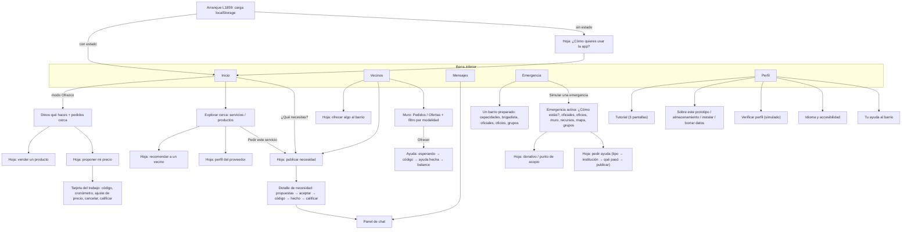
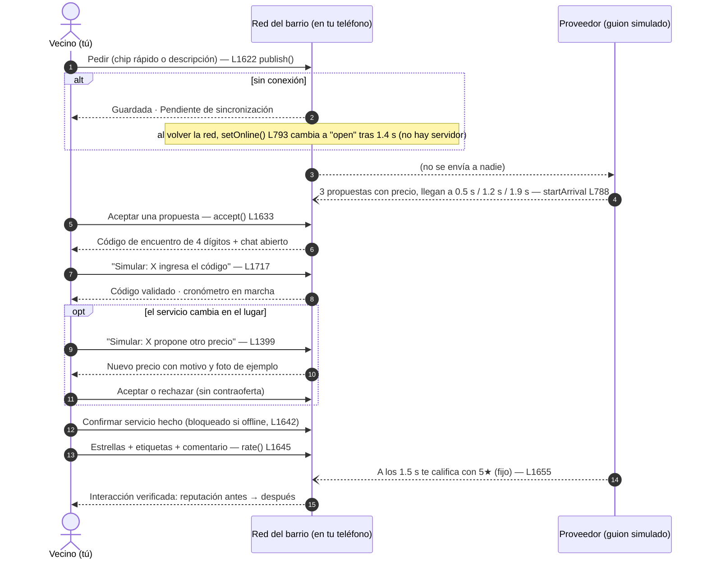

# Análisis y veredicto — "Red del barrio" (PWA, `index.html`)

**Alcance:** Fase 1, solo lectura. Se leyeron las 1,876 líneas de `index.html`, `sw.js`, `manifest.webmanifest`, `README.md`, `GUION-DEMO.md`, `INFORME-ESTADO-ACTUAL.md` y los títulos de `Informe técnico…md`, `Guía técnica de implementación.md` y `Simulador Red Vecinal.html` (versión anterior). Las referencias `L123` son líneas de `index.html`.
**Etiquetas:** **HECHO** (verificado en el código) · **INTERPRETACIÓN** · **HIPÓTESIS** · **REQUISITO** (del reto).
**Regla de lectura:** el informe del equipo es autodeclarado; aquí manda el código.

---

## a) Mapa de lo que existe hoy

### a.1 Pantallas y navegación

Una sola página (`#phone`) con cinco pestañas inferiores y capas encima (hoja inferior, panel de chat). Todo se dibuja con `render()` (L1601) reemplazando `innerHTML`.

Elementos transversales: botón de idioma y botón **Online/Offline** en la barra superior (L1322-1323), banner de modo emergencia, *toast* de confirmación (3.6 s, L785), panel de error de render (L1597).

### a.2 Flujo de punta a punta (el flujo REAL de la sección 3 del contexto)

Línea punteada = interlocutor **simulado** por un guion de `setTimeout` (no hay otra persona).

**HECHO:** en el lado "pedir", la persona que acepta es el usuario real y el proveedor es siempre el mismo guion. En el lado "ofrecer" (L660-724) ocurre lo inverso: el usuario es el proveedor y el cliente es un guion (`JOBPEOPLE`, L472).

### a.3 Funciones del MVP y su estado

✅ completa (la lógica funciona de punta a punta en el dispositivo) · 🟡 parcial · ⚠️ simulada (no hay otra parte real, o el dato es inventado).

| # | Función | Estado | Observación verificable |
|---|---|---|---|
| 1 | Publicar necesidad (4 tipos, plazo, detalles opcionales) | ✅ | `publish` L1622; preguntas guiadas `DQ` L423 |
| 2 | Recibir propuestas y ordenarlas (reputación/cercanía/precio) | ⚠️ | Las 3 propuestas son constantes de `CAT` (L354); distancias y precios fijos |
| 3 | Aceptar → código de 4 dígitos → chat | 🟡 | Código con `Math.random`; en el lado cliente la validación es un botón “Simular” (L1717) |
| 4 | Ajuste de precio (motivo + foto, sin contraoferta) | 🟡 | Lado cliente: botón “Simular: X propone otro precio”; lado proveedor: el cliente “decide” solo (acepta si sube ≤35 %, L705) |
| 5 | Cancelar con ventana de gracia, causas y penalización de cumplimiento | ✅ | `cancelInfo` L435; ventana de 30 s “de demo” |
| 6 | “¿No llegó?” (no show) | ✅ | Espera de 15 s de demo (L419) |
| 7 | Cerrar y calificar en dos sentidos | ⚠️ | La calificación del otro llega por temporizador, siempre 5★ (L1655) |
| 8 | Reputación de servicio y entre vecinos (separadas) | 🟡 | Se actualizan promedios locales; “entre vecinos” suma siempre 5 (L1652) |
| 9 | Explorar cerca: servicios/productos, rubro, orden | 🟡 | UI completa; los 15 negocios/vecinos son de ejemplo (`EXPL` L377) |
| 10 | Distancia “desde tu GPS” | ⚠️ | GPS real, pero la posición de cada vecino se *calcula* con un desplazamiento fijo sobre el centro redondeado (L396-400) |
| 11 | Visto Bueno Vecinal (cifra en tarjeta) | ⚠️ | Valores constantes (`vb:14`…); no sube con interacciones (ver §b) |
| 12 | Recomendar (1 voto, quitable) | 🟡 | Marca local por dispositivo (`S.recs`, L1771) |
| 13 | Recomendar a un vecino nuevo (“sin verificar”) | ✅ | Hasta 20 entradas locales (L1769) |
| 14 | Ofrecer mi servicio (oficio + disponibilidad, sin precio) | ✅ | `publishOffer` L660 |
| 15 | Recibir pedidos y proponer MI precio (obligatorio) | ⚠️ | Los pedidos (`JOBPEOPLE`) aparecen por temporizador tras publicar tu oficio |
| 16 | Trabajo en curso: cronómetro, código, ajuste, cierre | 🟡 | Código real comparado en el lado proveedor (L1718); lo demás guion |
| 17 | Vender un producto + propuestas de compra | ⚠️ | 3 compradores falsos aparecen en 1.2/2.4/3.6 s (L732-735) |
| 18 | Muro Pedidos / Ofertas con filtro por modalidad | ⚠️ | Contenido constante (`REQS`, `OFRS` L829-842); lo que publicas va a “Mis ofertas/pedidos” |
| 19 | Pedir/ofrecer ayuda entre vecinos (código, “Ayuda hecha”, balance) | ⚠️ | `hStart` → a los 1.2 s “X aceptó” (L881-886); `hCode` lo pulsa el propio usuario |
| 20 | “Tu ayuda al barrio” (evidencia sin puntos visibles) | 🟡 | Contadores locales; máx. 2 con la misma persona ✅ (L864-874) |
| 21 | Mensajes / chat con frases rápidas | ⚠️ | Respuestas por regex y guion (`replyFor` L543) con “escribiendo…” falso |
| 22 | Modo emergencia (5 tipos, violencia privada) | 🟡 | Es una **simulación de sismo** (banner L1325); no existe activación “real” |
| 23 | Pedir ayuda (SOS) con tipo, qué pasó, necesidades | 🟡 | Se publica en una lista local; a los 1.8 s “alguien acepta” (L1000) |
| 24 | Compartir ubicación exacta solo con quien aceptó | ⚠️ | Solo cambia un indicador (`shared:true`, L1790); no se envía nada |
| 25 | Institución oficial primero + enlaces `tel:` | 🟡 | `officialHTML` L943; números sin verificar; aparece **después** de “¿Cómo estás?” en la pantalla activa |
| 26 | Oficios y vecinos que pueden ayudar ahora (7) | 🟡 | `EEM` L1060; sin acción real (solo “Pedir ayuda”/“Ver perfil”) |
| 27 | Muro de emergencia + confirmar reporte | ⚠️ | 4 reportes constantes (`ENEEDS` L485) |
| 28 | Mapa | ⚠️ | SVG esquemático con posiciones fijas; **no usa el GPS** (`mapSVG` L1472) |
| 29 | Recursos, donativos y puntos de acopio | 🟡 | Promesas locales; “Ya entregué (simulado)” (L976) |
| 30 | Proponer punto de acopio (sin verificar) | ✅ | L1799 |
| 31 | Capacidades y brigadista voluntario | 🟡 | Interruptores locales sin efecto |
| 32 | Tutorial | 🟡 | 3 pantallas de texto (L495); aviso en Inicio |
| 33 | Idiomas es/en/qu | 🟡 | ~20 claves (L814-818); el resto sigue en español; quechua marcado “debe revisarlo un hablante nativo” ✅ |
| 34 | Alto contraste, texto grande, alertas visuales + vibración, preferencia de comunicación | 🟡 | Existen; implementación débil (ver §f) |
| 35 | GPS real, zona ~1 km | ✅ | `askGeo` L1186; redondeo a 0.01° |
| 36 | Abrir sin conexión (Service Worker + localStorage) | ✅ | `sw.js`; solo con HTTPS o localhost |
| 37 | Cola de pendientes | 🟡 | Solo publicar, SOS y mensajes (ver §e) |
| 38 | Fotos reducidas, sin EXIF, presupuesto y limpieza | ✅ | `readImg` L1236, `stripPhotos` L1230 |
| 39 | Video adjunto | ⚠️ | Solo se guarda el **nombre** del archivo (L1845) |
| 40 | Verificación de perfil con DNI | ⚠️ | Simulada; el DNI tecleado se guarda en localStorage |
| 41 | Panel de error | 🟡 | Solo errores de dibujado (`safeHTML` L1596) |
| 42 | “Migración” de datos viejos | 🟡 | Parches `normalizeLoaded` L1282; sin versión de esquema |
| 43 | Instalación como app | ✅ | `manifest.webmanifest`, `beforeinstallprompt` |
| 44 | Pruebas automáticas | ❌ | **No existen en el repositorio** |

### a.4 Modelo de datos inferido (localStorage)

Una sola clave, `redvecinal.v8` (L1183), con `JSON.stringify({uid, S, PROV})` (L1253). Se excluyen `toast`, `chatOpen`, `sheet`, `composer`, `wipeAsk`. Límite práctico ~5 MB (por eso el presupuesto de fotos de 2.4 MB, L1218).

| Entidad (campo en `S`) | Campos principales |
|---|---|
| `needs[]` — necesidades que **yo** pido | `id` (contador), `type` (servicio/producto/prestamo/ayuda), `text`, `status` (pending, syncing, open, accepted, waiting, done, cancelled), `arrived`, `sort`, `stage`, `chosen` (proveedor), `when`, `det` {q[], text, photoUrl base64, video nombre}, `mod`, `code`, `verified`, `accAt`, `startedAt`, `dur`, `price`, `adj` {state, from, to, motive}, `rating`, `comment`, `repLog`, `cliR/cliT` |
| `jobs[]` — pedidos que **recibo** como proveedor | `id`, `kind` (servicio/venta), `who`, `d`, `when`, `text`, `pay`, `pnum`, `status` (new, sent, accepted, toRate, waiting, done, cancelled), `code`, `verified`, `adjState`, `adjTo`, `adjLog[]`, `diag`, `det`, `cr` (reputación del cliente), `myRate`, `myComment` |
| `offers[]` / `od` | `{id, k, av}` oficios que ofrezco |
| `sales[]` | `{id, text, price, photo, status, offers[{who, price, list, state, cr}]}` |
| `chats{}` | `key → {name, sub, kind, msgs[{from, t, pend}], replyN, typing}` |
| `sol` | `{pts (sin uso), helps, people{nombre→n}, ratedSum, ratedN, ms, log[], lastBal}` |
| `hlp{}` | ayudas entre vecinos: `id → {st: off/acc/doing/rating/done, code, t0}` |
| `posts[]` | mis SOS: `{id, k, why, needs[], priv, st: pub/pending/res, acc{who, shared}}` |
| `recs{}`, `recNew[]` | mis recomendaciones: `clave → 1`; nuevas `{name, tr}` (máx. 20) |
| `acopios[]`, `pledge{}`, `conf{}`, `caps{}`, `brig`, `estado` | emergencia |
| `me` | `{vec, svc, cli: {r, n}, cumpl: {pct}, adj: {n, ok}, unj}` |
| `geo` | `{st, lat, lng, acc, alat, alng}` — **lat/lng exactos persistidos**; `alat/alng` redondeados |
| Ajustes | `lang, hc, big, vis, comm, role, mode, tut, tip, online, manualOff` |
| `verified`, `v` | `{dni, consent, selfie}` — el DNI se persiste |
| `PROV` (fuera de `S`) | 18 proveedores de ejemplo con `svc{r,n}`, `vec{r,n}`, `vb`, `adj{n,of,unj}`, `comments[]` |

**Constantes embebidas en el código (no se guardan):** `CAT` (propuestas), `EXPL` (directorio), `REQS`/`OFRS` (muro), `ENEEDS`, `ETYPES`, `OFFICIAL`, `EGROUPS`, `RNEED`, `ACOP0`, `TUT`, `I18N`.

---

## b) Verificación del informe contra el código

| # | Lo declarado | Lo encontrado | Discrepancia |
|---|---|---|---|
| 1 | “Máximo 3 clics (acciones principales en 2-3)” | El contador “Clics: x de 3” (L1503) usa `composerClicks` (L783): cuenta tipo + “haber escrito” + publicar y **no cuenta el toque que abre la hoja**. Pedir con atajo = 2 ✅; pedir texto propio = **4 toques reales**; ofrecer = 4-5; vender = 4-5; pedir ayuda en emergencia = 4-6 (ver §d) | **Parcial.** El contador subestima por 1 y no cubre las demás acciones |
| 2 | “En ‘Explorar cerca’ pide un servicio en 2 toques” | `exAsk` → `openComposer(..., chip=true)` (L1775) y luego Publicar | **Cierto** |
| 3 | “La distancia sale del GPS real” | `exDist` (L396): hay GPS real, pero cada vecino se *sitúa* a `dm` metros del **centro redondeado a 0.01°**. Error de hasta ~0.8 km (p. ej. “300 m” puede mostrarse entre 30 m y ~1.1 km) | **Engañoso.** El GPS es real; las distancias son sintéticas y poco fiables |
| 4 | “Cada tarjeta dice ‘Recomendado por X vecinos de tu zona’” | El X sale de constantes (`vb:14`, `vb:9`…, L339-374) | **Es dato inventado** presentado como hecho en la tarjeta |
| 5 | “El Visto Bueno sube tras una interacción confirmada” | `rate()` (L1645) modifica `svc.r/n` y `vec.r/n`; **nunca `vb`**. La búsqueda de `vb +=` no encuentra nada. Lo que sube es “interacciones confirmadas” (`inter`), no el Visto Bueno | **Falso** |
| 6 | “Un voto por persona, se puede quitar” | `S.recs[rk]` alterna 1/borrar (L1771) | **Cierto por dispositivo.** No existe el concepto de persona; reinstalar/borrar datos permite repetirlo. Además, en `propCard` (L1384) el recuento ignora tu voto, y en el perfil (L1517) sí lo incluye: inconsistente |
| 7 | “Recomendar a un vecino queda ‘sin verificar’” | ✅ (L1364, L1769). Hasta 20 | Cierto |
| 8 | “El proveedor no publica precio; la app no deja enviar sin precio” | `sendProposal` exige un dígito (L688). Acepta “0”; `num()` devuelve **35 por defecto** si no hay dígitos (L428), usado en el ajuste (L700) | **Cierto, con un defecto menor** (precio 35 silencioso) |
| 9 | “Se genera un código de 4 dígitos y hay un chat” | ✅ L1636 / L693. El chat es simulado | Cierto; interlocutor simulado |
| 10 | “Ajuste de precio: solo cambia si el vecino acepta. Sin contraofertas” | ✅ en la UI. Hay código muerto de contraoferta (`offCtr`, `adjCtr`, `adjAccC`, `adjState==='counter'`) sin ningún botón que lo dispare (verificado con búsqueda de `data-act`) | Cierto en la UI; **código muerto no declarado** |
| 11 | “Calificación en los dos sentidos” | ✅ en la lógica; la otra parte es un temporizador (5★ fijo) | **Simulado** |
| 12 | “Reputación de servicio y entre vecinos, por separado” | ✅ | Cierto |
| 13 | “No hay puntos, puestos, prioridad ni ventaja comercial; cada persona ve solo su propio resumen” | Los puntos existen en el código (`s.pts`, `CFG.pts`, `solSeedRaw`) pero no se muestran en la app (la guía oculta sí los menciona). **Pero:** el **nivel** (“Vecino solidario”) sí es público (“Así te ven los demás”, L1024), y los perfiles de otros muestran “N ayudas vecinales” (L1522). El aviso al confirmar un reporte dice “Pesa más por tu nivel Vecino solidario” (L1789), lo cual **contradice** “no da prioridad”; en el código no pesa (`cn=x.conf+1`, L956) | **Parcial.** Puntos no públicos ✅ (regla 4); pero hay nivel público, contadores públicos y un texto que promete peso inexistente |
| 14 | “Anti-abuso: una ayuda cuenta solo si ambos confirman, máximo 2 con la misma persona” | **Máx. 2:** ✅ (`times<2`, L870). **Ambos confirman:** el que ayuda pulsa “Validar código (simulado)” él mismo (L902) y la calificación del otro es automática; los donativos se auto-confirman con “Ya entregué (simulado)” y suman “ayudas confirmadas” (L1796) | **Máx. 2 cierto; “ambos confirman” simulado; donativos sin contraparte** |
| 15 | “Tipos de emergencia: sismo, incendio, médico, persona mayor, violencia (privada)” | ✅ `ETYPES` L844. Violencia: `priv:true`, no sale en el muro. **Pero** el texto afirma “Se avisó a contactos de confianza y brigadistas voluntarios” (L953, L988) y **no existe** forma de definir contactos de confianza; el aviso es falso | **Cierto en la lógica; texto engañoso** |
| 16 | “En emergencia siempre va primero la institución oficial” | En la hoja SOS la tarjeta de la institución aparece **después** de elegir el tipo (L985). En la pantalla de emergencia activa, el bloque “¿Cómo estás?” (L1092) va **antes** de “Servicios oficiales” (L1097). En la pestaña de preparación, las capacidades y “Simular una emergencia” (L1083-1085) van antes de “Servicios oficiales” (L1086) | **Parcial.** Se cumple dentro de la hoja (tras elegir) y como sección, no como primer elemento visible |
| 17 | “La ubicación exacta NO se muestra en público; zona ~1 km; la exacta solo quien aceptó” | La zona: ✅ (`alat/alng` a 0.01°). Nada sale del dispositivo (no hay red). “Compartir ubicación exacta con X” solo cambia un indicador. Las direcciones (`addr`) de pedidos de ejemplo se ven solo tras “aceptar” en la UI, pero **están en el código fuente**. Las coordenadas exactas del usuario se muestran con 5 decimales (L950) | **Cierto como diseño de UI; no es una garantía técnica.** En el MVP no hay terceros a quienes exponer |
| 18 | “Brigadista vecinal voluntario (sin verificar)” | Interruptor local sin efecto (L1084, L1800) | Cierto; **solo etiqueta** |
| 19 | “Cualquier vecino puede proponer un punto de acopio (sin verificar)” | ✅ L1799. Pero el formulario dice “Disponible para Vecino solidario” (L1169) y no hay restricción | **Texto contradictorio** |
| 20 | “‘Oficios y vecinos que pueden ayudar ahora’ (7)” | ✅ `EEM` L1060: 4 de `EXPL` + 3 fijos | Cierto |
| 21 | “Mapa” | `mapSVG` (L1472): radar SVG con anillos de 250/500/750 m y posiciones fijas (`ERES`, `EGROUPS`, `ENEEDS`); no usa `S.geo` | **No es un mapa geolocalizado** |
| 22 | “Grupos de apoyo” | 5 grupos con distancia fija y la frase “contacto guardado en tu teléfono” (L1487); **no hay ningún contacto ni teléfono** | **Texto falso** |
| 23 | “Abre sin conexión y deja las solicitudes en una cola hasta que vuelve la señal” | Cierto para **publicar, SOS y mensajes**. La “sincronización” es un temporizador (L803-806) y emite “Sincronizado. Ya llegan propuestas.” sin servidor (ver §e) | **Parcial; “Sincronizado” es falso** |
| 24 | “Fotos reducidas y guardadas; si se llena, quita las más antiguas, avisa y no pierde datos; el perfil muestra el uso” | ✅ L1218-1277, L1209-1211 | **Cierto** (verificado la lógica; no probado con almacenamiento lleno real) |
| 25 | “Panel de error con botón para volver a Inicio si falla una pantalla” | ✅ para fallos de dibujado (L1596-1600). No hay `window.onerror` ni `try/catch` en `act()` (L1678) | **Parcial** |
| 26 | “Los datos viejos se actualizan solos (migración de esquema)” | `fresh()` + superposición de claves guardadas (L1862) + parches (L1282). **No hay número de versión.** Si cambia `KEY`, se pierde todo; si `needs` no es arreglo, se descarta el estado en silencio (L1280) | **Parcial** |
| 27 | “Pruebas automáticas con navegador (flujos, estado viejo, persistencia, emergencia, clics aleatorios en 5 semillas)” | **No hay ningún archivo de prueba** en el repositorio (`git ls-files`: HTML, SW, manifest, íconos, docs). El único vestigio es `?demo=1` (L1308) que no hace nada | **No verificable.** Los escenarios existen solo como descripción |
| 28 | “Accesibilidad: alto contraste, texto grande, alertas visuales y vibración, frases rápidas con pictogramas” | Existen los tres interruptores (L1031). “Frases rápidas”: 4 frases con **emoji** (✋📍🆘✅, L823), no pictogramas propios. “Texto grande” = `zoom:1.18` en 3 contenedores (L280) | **Parcial** |
| 29 | “Idiomas español, inglés y quechua” | ~20 claves (L815-817). El nombre “Runasimi (quechua)” y la advertencia están ✅ | Cierto, parcial como se declara |
| 30 | “Queda código sin uso de una guía de demo anterior” | Más de lo dicho: la guía (L1581-1592, 10 `CASES`), puntos/ranking (`CFG`), `MARKET`, `solSeedRaw`, la constancia (`cons`, L1144; **sin botón de entrada**), `DIR`, `sancLevel`, `msort`, `helpNeed` duplicado. La guía está **siempre oculta** (L285 + L1310) pero se vuelve a generar en cada `render()` | **Subdeclarado** (~15-20 % del archivo) |
| 31 | *(No declarado)* | Botones de demostración visibles al usuario final: **“Simular: X ingresa el código”** (L1438), **“Simular: X propone otro precio”** (L1391), **“Demo: avanzar 45 min”** (L1435, L618), **“Código de demo: …”** (L594), **“Usar ejemplo”** (L462) | **No declarado.** Rompen la credibilidad si alguien los toca |
| 32 | *(No declarado)* | Interruptor **Online/Offline** en la barra superior (L1323): lo puede tocar cualquier usuario y `manualOff` se **guarda** (L1681); la app queda “Offline” tras reabrirla sin que nada lo explique | **No declarado; riesgo de confusión real** |
| 33 | *(No declarado)* | Si la app se cierra mientras una solicitud está “Sincronizando…”, al reabrir `normalizeLoaded` la pasa a **“open”** (L1289): queda “enviada” sin haberse enviado | **No declarado; viola “nunca mostrar como enviada una operación pendiente”** |
| 34 | *(No declarado)* | Recarga forzada al actualizar el Service Worker (L1315) puede interrumpir un formulario a medias | No declarado |
| 35 | *(No declarado)* | El DNI de la verificación simulada se guarda en localStorage (L1827 → `snapshot`) | No declarado; riesgo de privacidad |

**Resumen:** de las 8 comprobaciones pedidas, cumplen del todo: *un voto por persona* (con la salvedad de dispositivo) y *máx. 2 ayudas con la misma persona*; cumplen **parcialmente**: *3 clics*, *offline*, *ubicación exacta*, *puntos no públicos*, *institución primero*, *panel de error*, *migración*; **no se cumple**: *el Visto Bueno sube tras interacción*.

---

## c) Veredicto honesto (lo peor primero)

Te hablo directo, porque prefiero que lo oigas de mí hoy y no del jurado mañana.

**1. Lo que el jurado va a probar primero —coordinación entre vecinos— hoy no existe.** (**HECHO**) No hay servidor, no hay cuentas, no hay una segunda persona en ningún flujo. Cada “vecino” que responde es un `setTimeout` con texto fijo (`startArrival` L788, `postAccept` L1000, `hStart` L881, `replyFor` L543, `jobRate` L714). Si un jurado instala la app en su teléfono, se encuentra solo. El **requisito 1** (“coordinación de necesidades y recursos entre vecinos”) y el criterio **Código y Programa** (“realiza completamente… la funcionalidad”) son los más débiles. No es un defecto del diseño: es que lo que hay es un *prototipo de experiencia*, no un sistema. Hay que decirlo así, y por eso la Etapa 2 (Supabase) no es un adorno: es lo que convierte el recorrido en verdad.

**2. El requisito de “máximo 3 clics para publicar” se cumple solo con atajos, y la forma de contarlo es discutible.** (**HECHO**) Pedir con un chip o desde una tarjeta de Explorar: 2 toques. Pedir con tus propias palabras: 4 toques (abrir, tipo, tocar el campo, publicar), aunque el contador interno muestre “3 de 3” porque no cuenta el primer toque. Ofrecer un oficio: 4-5. Vender: 4-5. Pedir ayuda en emergencia: **6**. El jurado ve el requisito literal; si alguien cuenta con el dedo, falla justo en la acción más importante (SOS). Esto es lo primero que arreglaría (ver §d).

**3. “Offline” es real en lo que abre y guarda, pero “sincronizar” es una escena.** (**HECHO**) El Service Worker y localStorage hacen que la app abra y recuerde sin red. Lo que sigue —“Sincronizando…”, “Sincronizado. Ya llegan propuestas.”— es un temporizador de 1.4 s que cambia una etiqueta y luego *inventa* tres propuestas (L803-806). Además solo tres operaciones usan la cola; ofrecer, vender, aceptar, proponer precio y calificar siguen funcionando “offline” como si nada. Para un jurado técnico, esto es **offline aparente** (R2) y contradice tu propia regla “nunca simular que una operación llegó al servidor”.

**4. La geolocalización es real en la entrada y falsa en la salida.** (**HECHO**) El GPS se lee de verdad, pero (a) los vecinos se *fabrican* alrededor de tu zona con un desplazamiento fijo, (b) el redondeo a 0.01° introduce hasta ~0.8 km de error en esas distancias, y (c) el mapa de emergencia ni siquiera usa el GPS. El **requisito 2** (“útil y comprensible”) queda a medias, y la lección 2022 (“la ubicación debe servir para decidir y actuar, no solo para mostrar marcadores”) aplica contra nosotros: hoy el mapa es decorativo.

**5. La confianza —tu diferenciador— tiene tres grietas.** (**HECHO**) (i) El Visto Bueno no sube tras una interacción confirmada, aunque el informe y el guion lo digan. (ii) Las cifras (“recomendado por 14 vecinos”) son inventadas y se muestran como hechos. (iii) Recomendar es una marca local sin identidad: cualquiera la repite borrando datos (R25). Es exactamente el flanco que un jurado atacaría (“¿cómo sé que no lo inflaron?”). La regla de §j lo arregla con poco código.

**6. Emergencia: es lo más persuasivo y lo más peligroso.** (**HECHO**) Si alguien usa “Necesito ayuda”, a los 1.8 s la app le responde “Marco Rivas quiere ayudarte”. Para violencia le dice que se avisó a contactos de confianza —que no existen—. Los números de emergencia son enlaces que marcan de verdad y están sin verificar. La pantalla activa pone “¿Cómo estás?” antes que la institución oficial. Para el jurado puede lucir; para una persona real puede crear una falsa sensación de auxilio (R10, R32). Ver §h.

**7. Innovación: hay una idea propia, pero se parece demasiado a 2024 en lo visible.** (**INTERPRETACIÓN**) Chat vecinal + mapa + offline + emergencias ya ganó en 2024. Lo que no vi en ningún antecedente documentado es el ciclo **necesidad → propuestas con precio del proveedor → código de encuentro → ajuste solo con acuerdo → calificación de dos vías → reputación sin puntos públicos**, y una misma red cotidiana que se activa en emergencia. Eso es diferenciador, pero hoy solo se *ve* si la demo recorre el ciclo completo (R16).

**8. Usabilidad y accesibilidad: más declaradas que logradas.** (**HECHO**) Cada acción reescribe toda la pantalla y destruye el foco (L1606), el “texto grande” es `zoom`, hay textos de 11-13 px, las confirmaciones desaparecen a los 3.6 s, y hay jerga (“Pendiente de sincronización”, “Reputación contextual”, “Visto Bueno Vecinal”). Para adultos mayores y baja alfabetización —tu público— eso pesa. La **calidad visual** es buena y el lenguaje es mayormente claro; el problema es estructural, no estético.

**9. Escalabilidad: el archivo único es un techo.** (**HECHO**) 1,876 líneas, estado global mutable (`S`), HTML por concatenación de cadenas, datos de ejemplo mezclados con lógica. No se puede probar por partes ni cambiar de almacenamiento sin tocar todo. Para el criterio **Escalabilidad** la migración hexagonal a Flutter *es* la respuesta, pero solo si en la demo se puede decir “cambiamos Drift por Supabase sin tocar el dominio” con un adaptador real.

**10. Lo que sí está bien (para no perder perspectiva).** (**HECHO**) El flujo de precio (el proveedor ve el problema antes de cotizar, el precio solo cambia con acuerdo), el código de encuentro, la separación de reputaciones, la regla de máximo 2 ayudas por persona, la gestión de fotos sin EXIF y con presupuesto, el modo oscuro, la honestidad de la pantalla “Sobre este prototipo”, y que ya se declaró qué es simulado. Eso es mucho más de lo que suele traer un prototipo de 48 h.

### Contra los 6 requisitos del reto

| Req. | Estado | Por qué |
|---|---|---|
| 1. Coordinación entre vecinos, también en emergencias | 🔴 Débil | Sin segunda persona real (hallazgo 1) |
| 2. Geolocalización útil y comprensible | 🟠 Media-baja | GPS real, distancias sintéticas, mapa no geolocalizado (4) |
| 3. Tutorial | 🟡 Media | 3 pantallas de texto; no guía por la acción real |
| 4. Móvil, máx. 3 clics para publicar | 🟠 Media | 2 con atajo, 4 propio, 6 en SOS (2) |
| 5. Online y offline, indicando qué requiere sincronización | 🟠 Media | Abre y guarda ✅; sincronización simulada; no indica qué requiere sync (3) |
| 6. Intuitivo y accesible | 🟡 Media | Diseño cuidado, accesibilidad frágil (8) |

### Contra los 6 criterios del jurado

| Criterio | Estado | Comentario |
|---|---|---|
| Usabilidad | 🟡 | Buena base visual; arreglar foco, textos, 3 clics y jerga |
| Confiabilidad | 🔴 | “Cumple el objetivo; estable”: sin datos reales; sin pruebas en el repo; sin manejo global de errores |
| Escalabilidad | 🟡→🟢 | Hoy 🔴 (archivo único); con la arquitectura hexagonal y adaptadores remotos puede ser tu mejor carta |
| Propuesta | 🟢 | Idea clara y con riesgos reconocidos; falta el beneficio para la institución (ver M12) |
| Código y Programa | 🔴 | Interfaz completa, funcionalidad simulada |
| Innovación y Creatividad | 🟡 | Ciclo de confianza ✅; lo demás ya apareció en 2024 |

**Requisito más flojo:** el **1** (coordinación real), y el criterio más flojo: **Código y Programa/Confiabilidad**, por la misma causa. **Cierre:** el trabajo de Flutter + Supabase no es “mejorar la app”, es **volver cierto** lo que hoy se actúa.

### Contra los antecedentes (especialmente 2024)

(**INTERPRETACIÓN**) Si el jurado recuerda 2024, verá: chat vecinal, mapa, offline y emergencias → “ya lo vimos”. Lo que debe quedar en su memoria es **el ciclo cerrado y la confianza sin puntos públicos**. Ver `00-benchmark.md`.

---

## d) Verificación de “3 clics”

**Interpretación propuesta (INTERPRETACIÓN, a confirmar con la organización si hubiera oportunidad):** “clic” = **cada toque** desde la pantalla de inicio de la app hasta que la acción queda **confirmada en pantalla**. Teclear una descripción no es un clic, pero tocar el campo para empezar sí lo es. Se cuenta el primer toque (el que abre). No se oculta ningún paso.

| Acción principal | Camino (toques) | Total real | Contador de la app | ¿≤ 3? |
|---|---|---|---|---|
| **Pedir** con atajo (chip “Gasfitero”) | chip → Publicar | **2** | “2 de 3” | ✅ |
| **Pedir** desde una tarjeta de Explorar | “Pedir este servicio” → Publicar | **2** | — | ✅ |
| **Pedir** con palabras propias | “¿Qué necesitas?” → tipo → tocar el campo (escribir) → Publicar | **4** | “3 de 3” | ❌ |
| **Pedir** con sugerencia | “¿Qué necesitas?” → tipo → sugerencia → Publicar | **4** | “3 de 3” | ❌ |
| **Pedir a un vecino** (préstamo/ayuda) | pestaña Vecinos → “Pedir algo…” (tipo ya elegido) → campo → Publicar | **4** | “2 de 3” | ❌ |
| **Aceptar** una propuesta | “Aceptar propuesta” | **1** | — | ✅ |
| **Proponer mi precio** (proveedor) | “Ver pedido…” → campo precio → “Enviar propuesta” | **3** | — | ✅ |
| **Ofrecer** mi oficio (1.ª vez, con la hoja de rol) | “Ofrezco un servicio” → “Agregar lo que hago” → oficio → Guardar | **4** | — | ❌ |
| **Ofrecer** mi oficio (rol “Busco ayuda”) | Perfil → rol → (Inicio) Agregar → oficio → Guardar | **5** | — | ❌ |
| **Vender** un producto | Vecinos → “Vender un producto” → descripción → precio → Publicar | **5** | — | ❌ |
| **Publicar** una oferta al barrio | Vecinos → “Ofrecer algo al barrio” → modalidad → texto → Publicar | **5** | — | ❌ |
| **Recomendar** (en una tarjeta) | “Recomendar” | **1** | — | ✅ |
| **Recomendar a un vecino** nuevo | “Recomendar a un vecino” → nombre → oficio → Recomendar | **4** | — | ❌ |
| **Activar emergencia** | pestaña Emergencia → “Simular una emergencia” | **2** | — | ✅ (es una simulación) |
| **Pedir ayuda (SOS)** desde cero | Emergencia → Simular → “Necesito ayuda” → situación → texto → Publicar | **6** | — | ❌❌ |
| **Pedir ayuda (SOS)** con el modo activo | “Necesito ayuda” → situación → texto → Publicar | **4** | — | ❌ |
| **Marcar “Estoy bien”** (modo activo) | botón | **1** | — | ✅ |
| **Cerrar y calificar** | “Servicio hecho” → estrella → Enviar | **3** | — | ✅ |

**Conclusión (HECHO):** las acciones *de bajo esfuerzo* (atajos, aceptar, recomendar, calificar) cumplen. Las acciones de **publicar con contenido propio** (pedir, ofrecer, vender, SOS) **no** cumplen la lectura estricta. Como el requisito dice “máximo de 3 clics para **publicar**”, hay que rediseñar esas rutas para mobile-ux sin sumar funciones:

1. **Pedir (objetivo 3):** botón fijo “Pedir” → elegir *tipo con sugerencias integradas* (cada tipo muestra 2-3 frases listas) → “Publicar”. La descripción personalizada es **opcional** (si se elige una sugerencia no hay que escribir).
2. **SOS (objetivo 3):** botón de ayuda siempre visible en emergencia (no depende de “activar el modo”) → situación → “Enviar” (qué pasó se **prellena** con la plantilla de la situación; editar es opcional).
3. **Ofrecer (objetivo 3):** elegir rol es **pregunta única al abrir**, no un paso; “Lo que hago” → oficio (chips) → Guardar.
4. **Vender (objetivo 3-4):** foto opcional, descripción y precio en **una sola pantalla** (no hojas encadenadas): abrir → llenar → publicar = 3 toques + escritura.
5. **Contador visible** (opcional): mantener el “Clics: x de 3”, pero **contando desde el primer toque**.

---

## e) Auditoría de offline

### e.1 Qué funciona de verdad sin conexión (HECHO)

| Capacidad | ¿Real? | Evidencia |
|---|---|---|
| Abrir la app sin red | ✅ (tras una primera visita en HTTPS/localhost) | `sw.js`: precarga `index.html`, manifest, íconos; *stale-while-revalidate* |
| Recordar datos entre sesiones | ✅ | `localStorage` (L1259) |
| Fuentes tipográficas | 🟡 | Google Fonts externas; sin red se usa la fuente del sistema |
| Primera visita sin red | ❌ | El SW se instala con la primera carga |
| Detección de red | 🟡 | `navigator.onLine` (L1184): no detecta “conectado sin internet” |

### e.2 Qué solo lo aparenta (HECHO)

| Elemento | Qué hace realmente |
|---|---|
| “Sincronizando… / Sincronizado. Ya llegan propuestas.” | `setTimeout` de 1.4 s → `status='open'` → `startArrival` inventa 3 propuestas (L803-806) |
| Chat pendiente | Mensaje con `pend:true`; al volver la red se marca enviado y llega una respuesta guionada a los 1.8 s (L567-573) |
| SOS guardado sin internet | `st:'pending'`; al volver, `postAccept` simula que “alguien acepta” (L1007) |
| “Mapa guardado en tu teléfono” (L1098) | Es un SVG estático, siempre disponible; no hay mapa que guardar |
| “Sin internet se sube al volver” (fotos/video, L465) | No se sube nada a ningún sitio |

### e.3 Comportamiento de la cola

| Aspecto | Hoy | Problema |
|---|---|---|
| Qué entra a la cola | Publicar necesidad, SOS y mensajes | Ofrecer oficio, vender, proponer precio, aceptar propuesta, ajustar precio, calificar, donar y recomendar **no** se encolan ni se bloquean (solo `nextStage` bloquea, L1642); los temporizadores siguen simulando respuestas “offline” |
| Estados visibles | Pendiente / Sincronizando / Abierta | No hay **Error**; no hay “Reintentar” |
| Errores | No existe camino de error (no hay red que falle) | Imposible probar la recuperación |
| Duplicados | No hay identificador de cliente (`++uid`); el reenvío es una única pasada: `pend.forEach` | Con servidor habría duplicados al reintentar. No hay idempotencia |
| Cierre durante “Sincronizando…” | Al reabrir pasa a `open` (L1289) | **Se muestra como enviada una operación que nunca salió** |
| Interruptor manual | Persistente (`manualOff`) | Confunde a usuarios reales |
| Orden | `S.needs.filter(pending)` | No hay orden garantizado ni reintentos con retroceso |

**Qué requiere sincronización (el reto lo pide indicar) — propuesta (INTERPRETACIÓN):**

| Funciona sin conexión | Requiere sincronización (queda “Pendiente”) | Requiere conexión (se bloquea con aviso) |
|---|---|---|
| Ver lo último guardado, abrir la app, ver el tutorial, contactos oficiales (si están guardados), preparar una publicación | Publicar necesidad / oferta / SOS, recomendar, mensajes | Recibir propuestas nuevas, confirmar “hecho” compartido con otra persona, mapa con tiles nuevos |

---

## f) Problemas de UX y accesibilidad (priorizados)

| Prio. | Problema | Evidencia | Criterio |
|---|---|---|---|
| P0 | **El foco se pierde tras cada acción** | `sc.innerHTML = sh` (L1606) reemplaza el árbol; el elemento enfocado desaparece | WCAG 2.4.3, 2.4.7, 3.2.x |
| P0 | **Modales sin `inert`/trampa/retorno de foco**; el fondo sigue accesible | `.sheet` enfocado una vez (L1610), sin devolver el foco; `aria-modal` no basta | 2.4.3, 4.1.2, 2.4.11 |
| P0 | **Tamaños de texto**: 11-13 px (`.facts dt` 11, `.note` 13, `.tabbar` 12); “texto grande” = `zoom:1.18` en 3 contenedores (L280), no respeta el ajuste del sistema | CSS | 1.4.4, 1.4.12 |
| P0 | **Confirmaciones efímeras**: *toast* de 3.6 s; oculto si el chat está abierto (L786) | `toast()` L785 | 2.2.1, 4.1.3 |
| P0 | **Jerga y carga cognitiva**: “Pendiente de sincronización”, “Reputación contextual”, “Visto Bueno Vecinal”, “cumplimiento”, “Código de demo” | Textos | 3.1.5, 3.3.2 (y regla inviolable 6) |
| P1 | Escritura obligatoria para publicar (mín. 3 caracteres) | L1500 | Baja alfabetización digital |
| P1 | Botones de simulación visibles (“Simular…”, “Demo: avanzar 45 min”) | §b-31 | Claridad |
| P1 | Interruptor Online/Offline de la barra tentador y persistente | L1323, L1681 | Confianza |
| P1 | Objetivos táctiles de 40 px (`.chip`, `.net`, `.linkbtn`); WCAG 2.2 AA exige 24 px (✅), pero el estándar del proyecto (48 dp) no se cumple | CSS L92, L68 | 2.5.8; R15 |
| P1 | Estado solo por color en estrellas/tabs (hay `aria-pressed`, pero no hay cambio de forma ni texto) | `.stars` | 1.4.1 |
| P1 | Inicio muy largo: formulario + 15 tarjetas + recomendar | `inicio()` | Usabilidad |
| P2 | Tutorial solo texto, sin guiar la primera acción | L1572 | Requisito 3 |
| P2 | `role="dialog"` sin `aria-labelledby` (etiqueta genérica “Detalle”) | L1576 | 4.1.2 |
| P2 | Sin “deshacer” al cancelar o rechazar | — | 3.3.4 |
| P2 | Animaciones solo respetan `prefers-reduced-motion` en el *toast*; el parpadeo del borde (`flash`) no | L213, L825 | 2.3.3 |
| P2 | Mapa SVG con una sola etiqueta; datos solo visuales | L1475 | 1.1.1 |

### Los 5 problemas más importantes frente a WCAG 2.2 AA y su arreglo

1. **Foco perdido por re-dibujado (2.4.3 / 4.1.2).**
   *Arreglo:* en Flutter, no reconstruir la pantalla completa; usar widgets con estado estable y `FocusScope`. Tras cada acción, mover el foco al **mensaje de resultado** (`SemanticsService.announce` + `Semantics(liveRegion: true)`). Regla: *después de una acción, el foco va al primer elemento nuevo o al mensaje de confirmación; nunca al principio de la pantalla.*
2. **Diálogos sin gestión de foco (2.4.3, 2.4.11).**
   *Arreglo:* usar `showModalBottomSheet`/`Dialog` de Material (atrapan y devuelven el foco), `Semantics(scopesRoute: true, namesRoute: true)` con título real, y botón “Cerrar” de 48 dp. Probar con TalkBack: el fondo no debe ser leído.
3. **Texto pequeño y “texto grande” no estándar (1.4.4, 1.4.12).**
   *Arreglo:* mínimo 14 sp para cuerpo y 12 sp solo para metadatos; respetar `MediaQuery.textScaler` del sistema y añadir un selector propio (100/130/160 %); en la maqueta, probar a 200 %. Quitar `zoom`. Evitar alturas fijas.
4. **Confirmaciones que desaparecen (2.2.1, 4.1.3).**
   *Arreglo:* mostrar el resultado **en la pantalla** (tarjeta “Listo: tu pedido está publicado” con el siguiente paso y botón), no solo un *toast*; si hay *toast*, ≥ 6 s, con botón “Cerrar”, y anunciarlo con `liveRegion`. No ocultarlo al abrir el chat.
5. **Lenguaje difícil y escritura obligatoria (3.1.5, 3.3.2; regla 6).**
   *Arreglo:* glosario de términos: “Pendiente de sincronización” → “Guardado en tu teléfono. Se enviará cuando haya internet”; “Visto Bueno Vecinal” → “Vecinos que lo recomiendan”; “Reputación contextual” → “Cómo te califican”; “Cumplimiento” → “Cuántas veces cumpliste”. Permitir publicar con **chips y frases** sin teclear; dictado del teclado; pictogramas propios con texto debajo.

---

## g) Auditoría de privacidad (textos que sugieren más de lo que la app hace)

| Dónde | Texto actual | Problema | Cambio propuesto |
|---|---|---|---|
| Sheet SOS (L988) | “…Si alguien acepta ayudarte, hablan por el chat de la app y tú decides si compartes tu ubicación exacta…” | En el MVP nadie puede aceptar; la aceptación es un guion | “**(Simulación)** En la versión con cuentas…” hasta tener personas reales |
| Toast SOS (L1004) | “Marco quiere ayudarte…” | Presenta una respuesta falsa como real | Prefijo visible “Respuesta de ejemplo:” |
| Caso violencia (L953, L988) | “Se avisó a contactos de confianza y brigadistas voluntarios” | **No existe** la función; riesgo real para una víctima | “Este prototipo **no avisa a nadie**. Si estás en peligro, llama a la Línea 100 o a la Policía (números por verificar)” |
| Compartir ubicación (L1790, L950) | “Compartiste tu ubicación exacta solo con X” y “Coordenadas que ve X: …” | No se comparte nada; además muestra coordenadas con 5 decimales | “(Simulación) En la versión con cuentas solo X vería tu ubicación exacta”; redondear/ocultar coordenadas en pantalla |
| Geo card (L1199) | “Tu zona real… En público se muestra una zona aproximada” | “En público” no existe aún; no dice que lo exacto se guarda en el teléfono | “Tu ubicación se queda en tu teléfono. Cuando haya cuentas, los vecinos solo verán una zona de ~1 km” |
| Compositor detalles (L465) | “Solo lo ven quienes te proponen… Quitamos la ubicación de tus fotos… Video: máximo 30 s… Sin internet se sube al volver” | Nadie lo ve; el video no se procesa ni se sube; “30 s” no se valida | Fotos: ✅ conservar la frase de EXIF. Video: “En este prototipo el video no se guarda” o quitar video |
| Grupos de apoyo (L1487) | “contacto guardado en tu teléfono” | No hay contacto alguno | Quitar la frase o añadir un contacto real verificado |
| Modo offline (L1098) | “Mapa guardado en tu teléfono” | El “mapa” es un esquema fijo | “Esquema de tu zona (no es un mapa real)” |
| Tarjetas Explorar (L1365) | “Recomendado por 14 vecinos de tu zona” | Cifra inventada | “Ejemplo: 14 recomendaciones” o ocultar la cifra hasta tener datos reales |
| Muro de emergencia (L959) | “Reportado por 5 vecinos” | Cifra inventada | Igual: “(ejemplo)” |
| Verificación (L1138-1139) | “Simulación… (Ley 29733)” + campo DNI | El DNI se **persiste** en localStorage (L1827); pedir “ficticio” no impide que alguien ponga el real | No guardar el DNI; en la demo usar solo botón “Verificar (simulado)” sin campo |
| Confirmar reporte (L1789) | “Pesa más por tu nivel Vecino solidario” | Promete peso que no existe y contradice “no da prioridad” | Quitar |
| Perfil / nivel (L1024) | “Así te ven los demás: Vecino solidario” | Nivel público (la regla 4 solo prohíbe puntos y puestos; pero conviene decidirlo) | Decisión explícita: mostrar solo “Ayudó a N vecinos” sin nivel con nombre, o mantener solo el distintivo |
| Chat (L578) | “Tu dirección exacta no se comparte en el chat… Conversación simulada.” | Correcto y honesto ✅ | Conservar |
| Perfil → Privacidad (L1057) | “Nunca se muestra tu dirección exacta” | Aceptable, pero en el MVP tampoco se muestra “a otros” porque no hay otros | Añadir “En este prototipo tus datos no salen de tu teléfono” |
| Política de datos | **No existe** (ni al abrir ni en Perfil) | R18 | Aviso breve + consentimiento antes de pedir GPS o crear cuenta |

---

## h) Emergencia: qué puede confundir o poner en riesgo (y qué advertir antes de mostrarla)

**Riesgos para una persona real (HECHO):**

1. **Respuestas falsas.** Pedir ayuda produce, en 1.8 s, “X quiere ayudarte”. Quien está en peligro puede creer que viene ayuda (L1000).
2. **Caso de violencia.** Dice que se avisó a contactos de confianza; no es cierto (L953, L988). Es el peor texto de la app.
3. **Números sin verificar con marcación directa.** `tel:` en 105/116/106/115/100 (L944). Aunque la tarjeta dice “Números por verificar”, el enlace marca al tocar. El caso “persona mayor” dice “tu municipalidad” como número (L847).
4. **Orden de la pantalla activa.** “¿Cómo estás?” (con “Estoy bien” y “Puedo ayudar”) está *encima* de las instituciones oficiales (L1092 vs L1097).
5. **Sin camino real.** No hay “emergencia real”: solo “Simular una emergencia”. Alguien en apuros no sabe si pulsa algo de verdad.
6. **Ubicación.** Si activaron el GPS, la pantalla muestra coordenadas con 5 decimales; una captura de pantalla compartida revelaría su posición.
7. **Texto de aviso.** Existe una nota al final (“Esta app no reemplaza a los servicios oficiales”, L1101), pero está al fondo de una pantalla larga.
8. **Mapa.** Parece ubicar a vecinos reales alrededor; son puntos fijos.

**Qué advertir antes de mostrarla al jurado (frases sugeridas):**
- “El modo emergencia es una **simulación** con datos de ejemplo; no contacta a nadie.”
- “Los números oficiales **no están verificados**; no los marquen.”
- “En esta demo nadie responde de verdad; las respuestas son de ejemplo.”
- No mostrar el flujo de **violencia** salvo que lo pregunten, y si se muestra, decir primero qué **no** hace.

**Arreglos mínimos para mobile-ux (sin funciones nuevas):** (a) la institución oficial como **primer bloque** en toda pantalla de emergencia y en el primer paso del SOS, antes de elegir el tipo; (b) banner permanente “Simulación: no avisa a nadie” hasta mobile-mejoras; (c) quitar el texto de “contactos de confianza”; (d) confirmar antes de `tel:`; (e) verificar los números con fuentes oficiales y fechar la verificación en `docs/`.

---

## i) Mejoras funcionales propuestas (alcance de mobile-mejoras)

Esfuerzo en horas de trabajo con ayuda de IA (**ESTIMACIÓN**, no medida). Impacto sobre el jurado: alto/medio/bajo. Prioridad: P0 imprescindible para la verdad de la demo · P1 muy recomendable · P2 si sobra tiempo · P3 descartar si hay presión.

| ID | Mejora | Tipo | Mejora el requisito / criterio | Impacto | Horas | Prior. | Etiqueta |
|---|---|---|---|---|---|---|---|
| M1 | **Cuentas y datos compartidos** (Supabase Auth con teléfono o correo + Postgres): pedidos, propuestas y tratos entre personas reales | Backend | Req. 1; Confiabilidad; Código y Programa | **Alto** | 10-14 | **P0** | HECHO: hoy no hay segunda persona. HIPÓTESIS: dos teléfonos reales demuestran el ciclo |
| M2 | **Cola de pendientes que sincroniza de verdad** (UUID, upsert, estados Pendiente/Enviada/Error con reintento) | Sync | Req. 5; Confiabilidad | **Alto** | 5-7 | **P0** | HECHO: el MVP solo simula (§e) |
| M3 | **Ubicación exacta forzada por RLS** (vista pública con zona de ~1 km; tabla con coordenadas exactas visible solo a quien aceptó) y pruebas con dos usuarios | Seguridad | Regla 3; R7; Confiabilidad | **Alto** | 4-6 | **P0** | — |
| M4 | **Regla anti-inflado del Visto Bueno** (§j) | Confianza | Innovación; Confiabilidad | **Alto** | 3-4 | **P0** | INTERPRETACIÓN: es el flanco más obvio de ataque |
| M5 | **Línea de tiempo compartida del trato** (Publicada → Con propuestas → Aceptada → En curso → Resuelta), visible en la app para ambos | Producto | Innovación (“seguimiento hasta resolución”); Usabilidad | **Alto** | 3-4 | **P0** | INTERPRETACIÓN: es lo que distingue de 2024 |
| M6 | **Seed de demostración** marcado como “ejemplo” (SQL), con 10-15 vecinos y 3 pedidos activos de la zona | Datos | R19; R17 | Medio | 2-3 | **P0** | — |
| M7 | **Contenido de emergencia verificado**: números oficiales con fecha, textos sin falsas promesas | Contenido | Req. 1; R10; regla 5 | **Alto** | 2 (más la verificación humana) | **P0** | — |
| M8 | **Realtime**: nuevas solicitudes y cambios de estado en vivo | Backend | Req. 1; Innovación | Alto en demo | 3-4 | P1 | — |
| M9 | **Chat del trato** en tabla de Supabase detrás de `DealChatGateway` | Backend | Req. 1 | Medio-Alto | 4-5 | P1 | — |
| M10 | **Adaptador Matrix/Synapse** (una room por trato) | Backend | Escalabilidad | Medio (el jurado casi no lo verá) | 10-14 | P2 | HIPÓTESIS: el plan B del chat basta |
| M11 | **Mapa real** (flutter_map) con vecinos reales de la zona + radar esquemático sin conexión | UX/Geo | Req. 2; lección 2022 | **Alto** | 5-6 | P1 (parte en mobile-ux) | — |
| M12 | **Consentimiento y política breve de datos** (Ley 29733; vigencia del reglamento por verificar) | Legal/UX | R18 | Medio | 2 | P1 | — |
| M13 | **Pantalla “Impacto del barrio”** para una institución (necesidades resueltas, tiempo medio de resolución, por zona; agregados, sin datos personales) | Producto | Criterio Propuesta (“beneficios a la institución”) | Medio | 3-4 | P2 | HIPÓTESIS |
| M14 | **Reportar y bloquear + consejos de lugar público** | Seguridad | R9 | Medio | 3 | P2 | — |
| M15 | **Revisión del quechua** por hablante nativo (tarea humana) | Contenido | R26 | Bajo-Medio | 0 (externa) | P2 | — |
| M16 | **Notificaciones push** | Backend | Req. 1 | Medio | 4-6 | P3 | R14 lo hace frágil |
| M17 | **Voz/dictado en el flujo principal y pictogramas propios** | Accesibilidad | Req. 6 | Medio | 3-4 | P1 (puede entrar en mobile-ux como UI) | — |
| M18 | **Moderación mínima** (cola de reportes) | Operación | R9 | Bajo | 3 | P3 | — |

**Fuera de alcance (no implementar):** formalización de negocios, SUNAT, RUC, facturación, contabilidad, IA financiera, verificación RENIEC, pagos reales.

---

## j) Confianza: ¿se puede inflar el Visto Bueno? Una regla

**Respuesta (HECHO):** sí. El botón “Recomendar” es una marca local por dispositivo (`S.recs`), sin identidad, repetible borrando datos o instalando de nuevo; “Recomendar a un vecino” permite crear hasta 20 entradas con nombres arbitrarios; y las cifras mostradas (14, 9, 18…) son constantes. Además `rate()` jamás actualiza el Visto Bueno.

**Regla propuesta (una sola):**

> **Una recomendación cuenta solo si nace de una interacción confirmada con ese proveedor (código de encuentro validado por ambas partes), y cuenta una vez por persona distinta.**
> El botón “Recomendar” aparece **al cerrar el trato**; fuera de ese momento, “Sugerir” guarda al vecino como *“Sugerido, sin verificar”* **sin cifra y sin sumar**.

**Cómo se implementa sin servidor (mobile-ux):**
- `VistoBueno(proveedor) = nº de interacciones confirmadas y cerradas con ese proveedor, en personas distintas`. Con una sola persona local, tu interacción suma como máximo 1 (clave `proveedor_id`).
- Las cifras de proveedores de ejemplo se muestran con la etiqueta “Ejemplo” y no se mezclan con las reales: p. ej. “Ejemplo: 14” en gris, y “Tuyo: 1 ✓” cuando cierres un trato.
- El caso de uso `CalcularVistoBueno` recibe el historial de interacciones y aplica la regla; testeable con adaptadores falsos.

**Cómo se refuerza con servidor (mobile-mejoras):**
- `recommendations(provider_id, recommender_id, interaction_id)` con `UNIQUE(provider_id, recommender_id)` y `interaction_id` obligatorio y **confirmado por ambos** (estado `closed`), forzado por RLS y por una función de base de datos (`SECURITY DEFINER`) — no por la UI.
- La zona del recomendador debe coincidir con la del proveedor (la zona se deriva del GPS aproximado verificado al registrarse).
- Cuentas con verificación por teléfono (OTP) para frenar cuentas múltiples (INTERPRETACIÓN: no elimina el abuso, lo encarece).
- Vista pública `visto_bueno` que devuelve un conteo, nunca la lista de personas.

**Costo honesto:** al empezar, los números reales son 0-3, no 14. Se compensa con datos de ejemplo claramente marcados (R19) y estados vacíos con guía.

---

## k) Demo de 3 minutos (resumen; el guion detallado está en `02-demo.md`)

**Orden:** (1) Abrir la app instalada, ya con zona activada, 15 s · (2) *Explorar cerca* → “Pedir este servicio” → publicar (2 toques) · (3) elegir una propuesta → código → servicio hecho → calificar, mostrando reputación antes → después · (4) pasar al modo avión: publicar otra necesidad → queda “Pendiente” → reconectar · (5) Emergencia (30 s) con el aviso previo de que es simulación · (6) Cierre.

**No tocar (simulado, riesgoso o confuso):** botones “Simular…” y “Demo: avanzar…”; el interruptor Online/Offline (usar modo avión real); verificación de DNI; flujo de violencia; idiomas (quechua); vender/contraoferta; mapa; constancia; chat con frases rápidas salvo que pregunten.

**Cómo decirlo sin restarle fuerza (INTERPRETACIÓN):** “Lo que van a ver es el **recorrido completo del producto** con vecinos de ejemplo. Lo que ya es **real**: su ubicación, el funcionamiento sin internet y el guardado en el teléfono. Lo que sigue es conectar a personas reales.” La honestidad *refuerza* la confianza, que es justo el tema del proyecto.

---

## l) Preguntas difíciles del jurado (respuesta honesta de 2 frases)

| Pregunta | Respuesta honesta |
|---|---|
| **¿Escala?** | Hoy es un prototipo de un solo archivo; por eso lo rehicimos con una arquitectura de puertos y adaptadores: cambiar el almacenamiento local por Supabase no toca el dominio ni las pantallas. Con PostGIS, la consulta “cerca de mí” se resuelve con un índice espacial; no probamos todavía con miles de usuarios (HIPÓTESIS). |
| **¿Cómo se sostiene?** | Es una hipótesis: servir a municipalidades o juntas vecinales como herramienta de coordinación y medición de impacto (necesidades resueltas), sin cobrar a los vecinos. Los pagos y la formalización quedan para una fase 2 que aún no está diseñada. |
| **¿Cómo arrancan sin masa crítica?** | Sembramos un barrio piloto con vecinos y oficios reales y mostramos sus datos como “ejemplo” hasta que haya reales; el modo emergencia y los préstamos no necesitan masa crítica de comercios. Lo validaremos con un piloto pequeño antes de prometer cobertura. |
| **¿Qué hay de real hoy?** | Es real el GPS, el funcionamiento sin conexión y el guardado; son de ejemplo los vecinos, precios y respuestas. En la versión con servidor, los datos se comparten entre personas. |
| **¿En qué se diferencia de la app ganadora de 2024?** | Aquella avisa y conecta ante riesgo; nosotros cerramos el ciclo —acordar precio, encontrarse con un código, calificarse— y usamos la misma red de uso cotidiano cuando llega la emergencia. Es una hipótesis que hay que probar con vecinos. |
| **¿Y si alguien miente o hace una estafa?** | Mitigamos con código de encuentro, calificación en dos sentidos y recomendaciones solo tras una interacción confirmada; no eliminamos el riesgo. Falta moderación y reportar/bloquear, que están planificadas. |
| **¿Qué pasa con la privacidad y la ubicación?** | A terceros solo se les muestra una zona de ~1 km; la ubicación exacta la ve únicamente quien aceptó ayudar, y eso lo fuerza la base de datos, no la pantalla. Faltan el consentimiento y la política de datos con la ley peruana vigente (por verificar). |
| **¿Y los adultos mayores sin smartphone o sin alfabetización digital?** | Reducimos la escritura con frases y pictogramas, y un familiar o la junta vecinal puede publicar por ellos; no lo hemos probado con ellos todavía. Lo medimos en una prueba con al menos dos personas ajenas al equipo. |
| **¿Por qué no usar WhatsApp?** | WhatsApp no mide el ciclo ni la reputación, ni protege la ubicación exacta. Podría ser un canal de notificación en una fase posterior (HIPÓTESIS). |

---

## m) Confirmación del stack y plan de las horas

### m.1 Revisión de la sección 5 contra el código real

| Pieza | Veredicto | Nota |
|---|---|---|
| Flutter + Dart, Material 3, Riverpod, go_router | ✅ | Sin cambios |
| Drift + migraciones | ✅ | Sustituye a localStorage; añadir `schemaVersion` real |
| `uuid` | ➕ añadir | Faltaba en la tabla; necesario para la cola con UUID |
| `geolocator` + `permission_handler` | ⚠️ quitar `permission_handler` | `geolocator` ya gestiona permisos de ubicación (justificación R22) |
| `connectivity_plus` | ✅ con cautela | Informa del *tipo de red*, no de internet real; en etapa 2 se complementa con un *ping* al servidor. Sin servidor en etapa 1 sirve de indicador |
| `flutter_map` + OSM | ✅ con cautela | Los tiles públicos de OSM no están pensados para precarga masiva (R43, por verificar); plan: tiles en línea con caché de lo visto **más el radar esquemático** como alternativa sin conexión |
| `image_picker` + `flutter_image_compress` | ✅ | Verificar con una foto real que no queda EXIF (R8); no soportar video en la demo |
| `url_launcher` | ➕ añadir | Necesario para `tel:` de contactos oficiales (con confirmación) |
| i18n con `intl`/`flutter_localizations` | ✅ con ajuste | El quechua (`qu`) no tiene localización de Material: delegado propio con *fallback* a español (R44) |
| Haptics | ✅ | Usar `HapticFeedback` del SDK; no añadir paquete `vibration` salvo que se necesiten patrones |
| Ajustes persistentes (idioma, contraste, texto) | ✅ en Drift | Evita `shared_preferences` |
| Etapa 2: Supabase, PostGIS, RLS, Realtime, Storage, Edge Functions | ✅ | Reutilizar el modelo de datos de la *Guía técnica de implementación* §5 (Capacitor/Vercel queda reemplazado por Flutter) |
| Matrix (SDK `matrix`) | ⚠️ riesgo | Sin E2EE en las rooms de demo; plan B (tabla de Supabase) debe construirse **primero** |

Las decisiones y la lista final de dependencias están en `docs/decisiones.md`.

### m.2 Qué entra en cada rama (orden de prioridad, protegiendo el recorrido de la demo)

**mobile-ux (sin servidor, equivalente al PWA — migrar solo lo que tiene entrada de UI):**

| Orden | Bloque | Horas (estim.) | Cubre la demo |
|---|---|---|---|
| 1 | Esqueleto hexagonal, tema base, error global, test de arquitectura, `flutter analyze` | 3-4 | — |
| 2 | Modelo de datos + Drift + migraciones + Outbox con UUID | 4-5 | Escenario offline |
| 3 | Ubicación (GPS real, permisos, zona ~1 km) y Explorar cerca | 3-4 | Principal |
| 4 | Publicar necesidad (3 toques), propuestas, aceptar, código, cierre y calificación | 6-8 | Principal |
| 5 | Ajuste de precio, cancelaciones, no-show | 3 | Principal (opcional) |
| 6 | Reputación, “Tu ayuda al barrio”, Visto Bueno con la regla de §j | 3 | Principal |
| 7 | Modo Ofrezco (oficio, pedidos, proponer precio) | 3 | Principal (lado proveedor) |
| 8 | Directorio y recomendar | 2 | — |
| 9 | Préstamos y muro de vecinos, donativos y acopio | 3-4 | — |
| 10 | Emergencia (con las correcciones de §h) | 4 | Corte de 30 s |
| 11 | Tutorial, ajustes de accesibilidad e idiomas | 3 | Req. 3, 6 |
| 12 | Pruebas de paridad + clics aleatorios | 4 | — |
| 13 | **Fase 3: sistema de diseño y revisión de accesibilidad** | 8-10 | Req. 6 |

Total mobile-ux: ~45-55 h (**ESTIMACIÓN**). Si el tiempo es menor, **recortar de abajo hacia arriba**: primero 9, 8, 7; nunca 3-6, que son la demo.

**mobile-mejoras (servidor):** M1, M2, M3, M4, M5, M6, M7 (P0) → M8, M9, M11, M12, M17 (P1) → M10, M13, M14, M15 (P2). Total P0 ≈ 30-40 h; P1 ≈ 20-25 h.

**Antes de la Fase 2 te preguntaré cuántas horas quedan** para fijar el corte.
