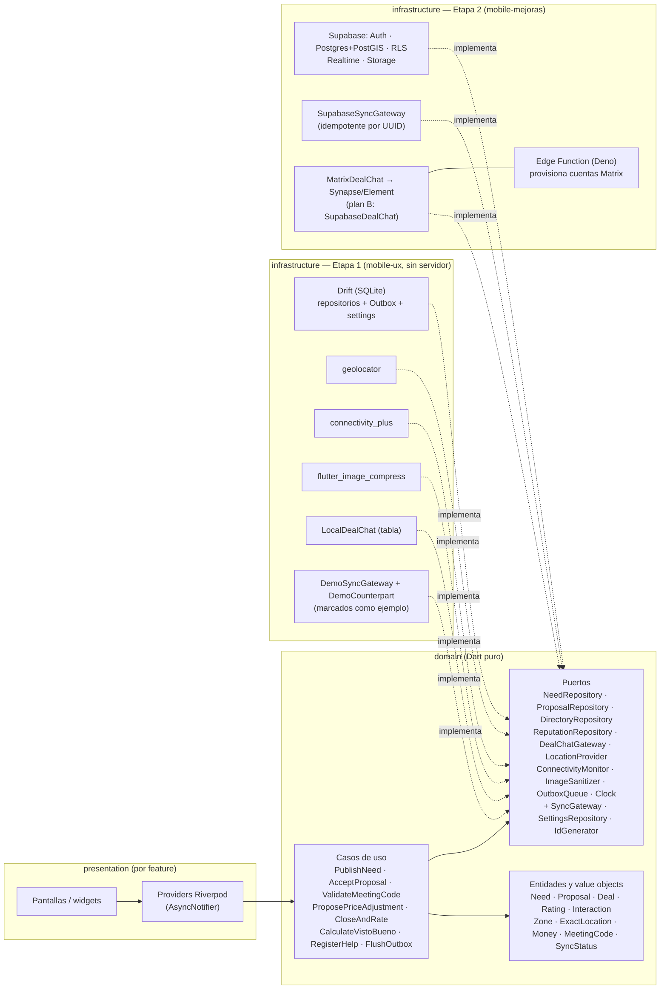
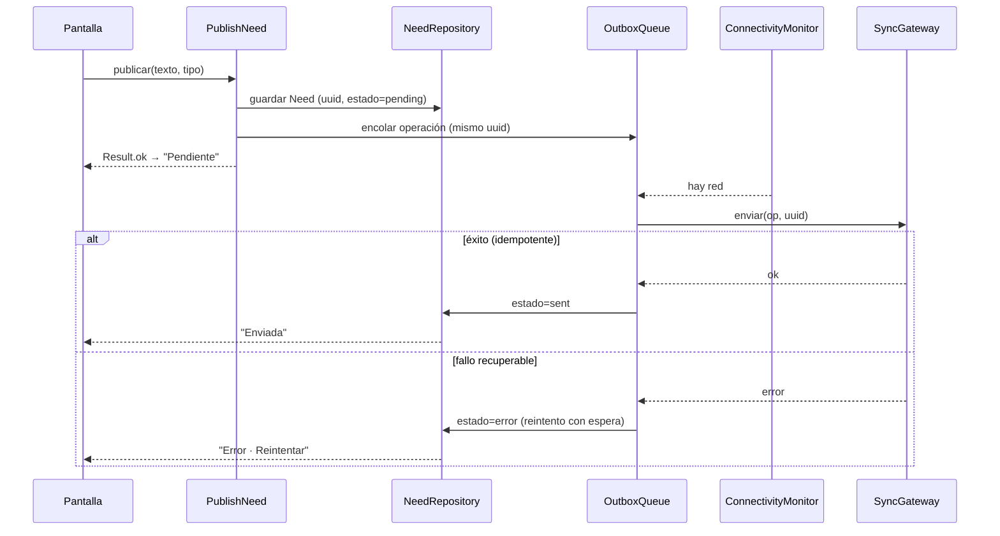

# Arquitectura — del PWA a Flutter hexagonal pragmática

Referencias `L123` = líneas de `index.html`. Etiquetas: **HECHO** (verificado en código) · **INTERPRETACIÓN** · **HIPÓTESIS**.

---

## a) Cómo está estructurado el PWA y su deuda técnica

**Estructura (HECHO):** un único `index.html` de 1,876 líneas: ~270 de CSS, ~25 de HTML y ~1,560 de JavaScript dentro de una función autoejecutable (L315-1873). Soporte: `sw.js` (41 líneas), `manifest.webmanifest`, 3 íconos.

```
datos de ejemplo (constantes)  ─┐
estado global mutable S         ├─► funciones que mutan S y llaman render()
temporizadores T[] (guiones)    │        │
                                ▼        ▼
         vistas = cadenas HTML  ─► innerHTML ─► eventos delegados data-act ─► switch(a) de ~130 casos (L1678)
                                                                │
                                          saveState() ─► localStorage (una clave, ~5 MB)
```

| Deuda técnica | Evidencia | Consecuencia para la migración |
|---|---|---|
| **Estado global único** (`S`) con ~60 claves | `fresh()` L535 | Hay que partirlo en agregados con dueño (necesidad, trato, reputación…) |
| **Dos modelos para lo mismo**: `needs[]` (yo pido) y `jobs[]` (yo cotizo) repiten código, cancelar, ajuste de precio, calificación | `getNeed`/`jobById`, `cancelRec` L757 | **Unificar en un solo `Deal`** con rol (solicitante/proveedor); es también la forma natural de una fila en Postgres |
| **Datos de ejemplo mezclados con lógica** | `PROV`, `CAT`, `EXPL`, `REQS`, `ENEEDS`… | Separar: *seed* de demostración (infraestructura) vs. reglas (dominio) |
| **Interlocutores falsos con `setTimeout`** | `startArrival`, `postAccept`, `hStart`, `replyFor`, `jobRate` | Aislarlos en un adaptador “demo” explícito (`DemoCounterpart`) etiquetado como ejemplo; desaparece en mobile-mejoras |
| **Persistencia = volcar todo el estado** (con fotos en base64) | `snapshot` L1253 | Tablas relacionales (Drift); fotos como archivos |
| **Sin versión de esquema** | `KEY='redvecinal.v8'`, `normalizeLoaded` L1282 | `schemaVersion` + migraciones con pruebas |
| **Vista y reglas mezcladas** (cadenas HTML con `if` de negocio) | `needDetail` L1405 | Casos de uso en dominio; widgets sin reglas |
| **Re-render total** | `render()` L1601 | Pérdida de foco y de accesibilidad (ver `01-analisis.md` §f); en Flutter, widgets con estado local |
| **Sin manejo de errores en acciones** | `act()` L1678 | `Result` en dominio + `runZonedGuarded` |
| **Código muerto** (~15-20 %) | guía L1581, `CFG.pts/vis/cap`, `MARKET`, `offCtr`, `adjCtr`, `cons` sin entrada | **No migrar** (D-8) |
| **Sin pruebas en el repositorio** | `git ls-files` | Reconstruir la paridad (sección f) |
| **i18n por diccionario de ~20 claves** | `I18N` L814 | `.arb` con *fallback* a español |
| **Números mágicos de demo** (15 s, 30 s, ×1.35, +45 min) | L419, L705, L1744 | Constantes de configuración; solo en la capa demo |

**Lo bueno que se conserva (HECHO):** la regla de precio, el código de encuentro, la separación de reputaciones, `registerHelp` (máx. 2 por persona), la política de fotos (re-codificar sin EXIF, presupuesto y limpieza), el vocabulario cercano del texto (cuando no es jerga).

---

## b) Mapeo de cada función del PWA a un feature, con puertos y adaptadores

**Features definitivos (derivados del mapa de §a de `01-analisis.md`):**
`needs`, `proposals`, `explore`, `directory`, `reputation`, `solidarity`, `emergency`, `location`, `sync`, `deals_chat`, `settings`.
*(Cambio frente a la lista del contexto: `loans` se integra en `solidarity` porque el PWA procesa préstamos con el mismo motor de pedidos y su “muro” comparte pantalla; ver D-6.)*

Unidades de dominio clave: **Need** (la publicación), **Proposal** (oferta de un proveedor), **Deal** (trato: propuesta aceptada con código, etapas, ajuste de precio y cierre), **Rating**, **Interaction** (trato cerrado y confirmado por ambos), **EmergencyPost**, **Zone** (≈1 km) / **ExactLocation**.

| Función del PWA (líneas) | Feature | Casos de uso (dominio) | Puertos usados | Adaptador **local** (mobile-ux) | Adaptador **remoto** (mobile-mejoras) |
|---|---|---|---|---|---|
| Publicar necesidad, plazo, detalles (L1622, L1499) | `needs` | `PublishNeed` | `NeedRepository`, `OutboxQueue`, `Clock`, `IdGenerator` | `DriftNeedRepository` + `DriftOutbox` | `SupabaseNeedRepository` (REST) |
| Atajos y sugerencias por tipo (L354, L1683) | `needs` | — (datos) | — | constantes en `needs/domain` | igual |
| Recibir y ordenar propuestas (L788, L1417) | `proposals` | `ListProposals` | `ProposalRepository` | `DriftProposalRepository` + `DemoCounterpart` (propuestas de ejemplo marcadas) | `SupabaseProposalRepository` + Realtime |
| Proponer mi precio (proveedor) (L685) | `proposals` | `ProposePrice` | `ProposalRepository` | Drift | Supabase |
| Aceptar propuesta y generar código (L1633) | `proposals` | `AcceptProposal` | `ProposalRepository`, `IdGenerator`, `DealChatGateway` | Drift | Supabase + `MatrixDealChat` o `SupabaseDealChat` |
| Validar código de encuentro (L1717, L1718) | `proposals` | `ValidateMeetingCode` | `ProposalRepository`, `Clock` | Drift | Supabase |
| Ajuste de precio con motivo/foto (L698, L1399) | `proposals` | `ProposePriceAdjustment`, `RespondPriceAdjustment` | `ProposalRepository`, `ImageSanitizer` | Drift; respuesta del vecino real (usuario) | Supabase |
| Cancelar, ventana de gracia, no-show (L435, L766) | `proposals` | `CancelDeal`, `ReportNoShow` | `ProposalRepository`, `Clock` | Drift | Supabase |
| Cerrar y calificar en dos sentidos (L709, L1645) | `reputation` | `CloseAndRate` | `ReputationRepository`, `ProposalRepository` | Drift; contraparte demo (marcada) | Supabase (la calificación del otro es real) |
| Reputación servicio/vecinos, “Tu ayuda al barrio” (L864, L1010) | `reputation` | `CalculateReputation`, `RegisterHelp` (máx. 2 con la misma persona, ambos confirman) | `ReputationRepository` | Drift | Supabase |
| **Visto Bueno con regla anti-inflado** (L408, L1771) | `directory` | `CalculateVistoBueno`, `RecommendAfterInteraction`, `SuggestNeighbor` | `DirectoryRepository`, `ReputationRepository` | Drift (regla local) | Supabase + `UNIQUE` + RLS |
| Explorar cerca: servicios/productos, rubro, orden (L1371) | `explore` | `ExploreNearby` | `DirectoryRepository`, `LocationProvider` | Drift (seed de demostración con coordenadas reales de la zona) | Supabase + PostGIS (`ST_DWithin`) |
| Promover mi oficio / vender producto (L660, L727) | `directory` | `PublishService`, `PublishProduct` | `DirectoryRepository`, `ImageSanitizer`, `OutboxQueue` | Drift | Supabase + Storage |
| Muro de pedidos y ofertas por modalidad (L921, L936) | `solidarity` | `ListWall`, `PublishOffer` | `NeedRepository` | Drift (seed marcada) | Supabase |
| Préstamos con entrega/devolución (L361) | `solidarity` | `ConfirmLoanStage` | `ProposalRepository` | Drift | Supabase |
| Ayuda entre vecinos con código y balance (L875-906) | `solidarity` | `OfferHelp`, `ConfirmHelp` | `NeedRepository`, `ReputationRepository` | Drift; confirmación de la contraparte demo | Supabase (ambos confirman de verdad) |
| Modo emergencia, SOS, tipos, privado (L981-1007) | `emergency` | `PublishSos`, `ShareExactLocation` | `NeedRepository`, `LocationProvider`, `OutboxQueue` | Drift; **sin respuestas falsas** | Supabase + RLS (ubicación exacta solo a quien aceptó) |
| Instituciones oficiales primero (L943) | `emergency` | — (contenido verificado y fechado) | — | constantes verificadas | igual (o tabla de contenido) |
| Oficios que pueden ayudar, grupos, acopio (L1060-1100) | `emergency` | `ListEmergencyHelpers`, `ProposeCollectionPoint` | `DirectoryRepository` | Drift | Supabase |
| Donativos y recursos (L971) | `emergency` | `PledgeDonation` | `NeedRepository` | Drift | Supabase |
| Capacidades y brigadista voluntario (L1080) | `emergency` | `SetCapabilities` | `DirectoryRepository` | Drift | Supabase |
| Mapa (L1472) | `explore`/`emergency` (presentación) | — | `LocationProvider` | `flutter_map` + radar esquemático offline | igual + datos reales |
| GPS real, zona ~1 km (L1186) | `location` | `GetCurrentZone`, `DistanceTo` | `LocationProvider` | `GeolocatorLocationProvider` | igual |
| Detectar conexión y cola (L1184, L793) | `sync` | `FlushOutbox`, `ObserveSyncState` | `ConnectivityMonitor`, `OutboxQueue`, `SyncGateway` | `ConnectivityPlusMonitor`, `DriftOutbox`, `DemoSyncGateway` | `SupabaseSyncGateway` (idempotente por UUID) |
| Fotos reducidas sin EXIF y presupuesto (L1236, L1218) | `needs`/`directory` | `SanitizeImage` | `ImageSanitizer` | `FlutterImageSanitizer` | igual + subida a Storage |
| Chat del trato + frases rápidas (L541, L574) | `deals_chat` | `SendMessage`, `ListMessages` | `DealChatGateway` | `LocalDealChat` (tabla Drift; **respuestas demo marcadas**) | `SupabaseDealChat` (plan B) → `MatrixDealChat` |
| Idioma, contraste, texto, vibración, comunicación (L1027, L825) | `settings` | `UpdateSettings` | `SettingsRepository` | `DriftSettingsRepository` | igual |
| Tutorial (L495) | `settings` (presentación) | — | — | pantallas + `OnboardingState` en Drift | igual |
| Panel de error y recuperación (L1596) | `app` | — | — | `ErrorBoundary` + `runZonedGuarded` | igual |
| Verificar perfil con DNI (L1136) | **no migrar** | — | — | — | Fuera de alcance (RENIEC) |
| Constancia de ayuda (L1144), guía de demo, puntos/ranking (`CFG`) | **no migrar** | — | — | — | Sin entrada en UI / contradice reglas |
| Contraoferta (`offCtr`, `adjCtr`) | **no migrar** | — | — | — | Sin entrada en UI; “sin contraofertas” |
| Video adjunto (L1845) | **no migrar** | — | — | — | Solo guardaba el nombre |

**Puertos:** los 10 mínimos del contexto (`NeedRepository`, `ProposalRepository`, `DirectoryRepository`, `ReputationRepository`, `DealChatGateway`, `LocationProvider`, `ConnectivityMonitor`, `ImageSanitizer`, `OutboxQueue`, `Clock`) **más tres** justificados en D-5, D-11 y D-12: `SyncGateway`, `SettingsRepository`, `IdGenerator`.

---

## c) Diagrama de la arquitectura hexagonal



**Regla de dependencias:** `presentation → domain ← infrastructure`. La *composición* (qué adaptador se usa) vive solo en `lib/app/di/` y es lo único que cambia entre mobile-ux y mobile-mejoras. Eso es lo que se mostrará al jurado en “Escalabilidad”.

**Flujo de escritura con conexión intermitente (el corazón del offline):**



---

## d) Árbol de carpetas

```
lib/
├─ main.dart                      # arranque: runZonedGuarded + ErrorBoundary + ProviderScope
├─ app/
│  ├─ app.dart                    # MaterialApp.router, tema, locales
│  ├─ router.dart                 # go_router (Inicio, Vecinos, Mensajes, Emergencia, Perfil)
│  ├─ theme/                      # ColorScheme, tipografía, modo emergencia, alto contraste
│  ├─ di/providers.dart           # ÚNICO lugar que elige adaptadores (local ↔ remoto)
│  └─ error/error_boundary.dart   # pantalla de recuperación (paridad con panel de error del PWA)
├─ core/
│  ├─ result.dart                 # sealed Result<T, Failure>
│  ├─ failure.dart
│  ├─ geo/geo_math.dart           # Haversine y redondeo a zona (Dart puro)
│  ├─ db/app_database.dart        # Drift: tablas, schemaVersion, migraciones (infraestructura compartida)
│  └─ config/app_config.dart      # constantes (ventana de gracia, tiempos de demo)
└─ features/
   ├─ needs/            { domain/{need.dart, need_repository.dart, usecases/publish_need.dart}, infrastructure/, presentation/ }
   ├─ proposals/        { domain/{proposal.dart, deal.dart, price_adjustment.dart, meeting_code.dart, usecases/*}, infrastructure/, presentation/ }
   ├─ explore/          { domain/{explore_nearby.dart}, infrastructure/, presentation/ }
   ├─ directory/        { domain/{provider_profile.dart, recommendation.dart, calculate_visto_bueno.dart}, infrastructure/, presentation/ }
   ├─ reputation/       { domain/{rating.dart, interaction.dart, calculate_reputation.dart, register_help.dart}, infrastructure/, presentation/ }
   ├─ solidarity/       { domain/, infrastructure/, presentation/ }   # muro, préstamos, ayudas
   ├─ emergency/        { domain/{emergency_post.dart, official_contact.dart, usecases/*}, infrastructure/, presentation/ }
   ├─ location/         { domain/{location_provider.dart, zone.dart}, infrastructure/geolocator_location_provider.dart }
   ├─ sync/             { domain/{outbox_queue.dart, sync_gateway.dart, flush_outbox.dart}, infrastructure/{drift_outbox.dart, demo_sync_gateway.dart}, presentation/sync_banner.dart }
   ├─ deals_chat/       { domain/{deal_chat_gateway.dart, message.dart}, infrastructure/{local_deal_chat.dart}, presentation/ }
   └─ settings/         { domain/{settings.dart, settings_repository.dart}, infrastructure/, presentation/ }   # idioma, accesibilidad, tutorial

test/
├─ architecture/domain_purity_test.dart   # falla si domain/ importa flutter, drift, supabase, matrix, geolocator…
├─ domain/                                # casos de uso con adaptadores falsos
├─ outbox/outbox_test.dart                # duplicados, reintentos, idempotencia
├─ parity/                                # escenarios del PWA (sección f)
├─ migration/                             # Drift: de esquema v1 a vN
└─ monkey/monkey_test.dart                # toques aleatorios con semilla
```

*Etapa 2 añade, sin tocar `domain/` ni `presentation/`:* `features/*/infrastructure/supabase_*.dart`, `features/deals_chat/infrastructure/{supabase,matrix}_deal_chat.dart`, y fuera de `lib/`: `supabase/{migrations,seed.sql,functions}`.

---

## e) Decisiones y justificación (resumen; el registro completo está en `docs/decisiones.md`)

| ID | Decisión | Justificación |
|---|---|---|
| D-1 | **Hexagonal pragmática por feature**, con *puertos solo en fronteras externas* (BD, red, GPS, cámara, chat, reloj) | El jurado evalúa **Escalabilidad**; la prueba es sustituir Drift por Supabase sin tocar dominio ni pantallas |
| D-2 | **`Result<T, Failure>` propio** (sellado), sin paquete | Evita `fpdart`/`dartz`; una clase y un `switch` bastan |
| D-3 | **Un `Deal` unificado** que reemplaza `needs` + `jobs` del PWA | Elimina duplicación; una fila en Postgres; la misma lógica de cancelar, ajustar y calificar para ambos roles |
| D-4 | **Riverpod sin generación de código** (`flutter_riverpod` + `AsyncNotifier`) | Menos tiempo de `build_runner`; Drift ya requiere uno |
| D-5 | **`OutboxQueue` + `SyncGateway`** (puerto adicional) | La cola decide *cuándo*; el gateway decide *a quién* envía. En etapa 1, `DemoSyncGateway` marca la operación como *“Enviada · barrio de ejemplo (demo)”*, **nunca** como enviada a un servidor |
| D-6 | **`loans` se fusiona en `solidarity`** | El PWA procesa préstamos con el mismo motor y el muro comparte pantalla |
| D-7 | **`core/db` aloja Drift** y las implementaciones de repositorios viven en cada feature | Una sola base y migraciones en un lugar; los features dependen de `core`, no al revés |
| D-8 | **No migrar código muerto**: contraoferta, constancia, puntos/ranking, guía de demo, DNI, video | No tienen entrada de UI o contradicen las reglas inviolables 4 y 1 |
| D-9 | **`DemoCounterpart` como adaptador explícito** | Para que el recorrido de la demo funcione sin servidor, las respuestas de ejemplo existen, pero se crean con `isDemo=true` y la UI muestra “Ejemplo”; **no** hay respuestas de ejemplo en el SOS |
| D-10 | **Interruptor Online/Offline del PWA → solo en modo depuración** (pulsación larga), no para el usuario | Evita el estado `manualOff` persistente que confundía |
| D-11 | **`SettingsRepository`** como puerto extra | Se justifica por testeo con un falso y porque en etapa 2 los ajustes pueden sincronizarse |
| D-12 | **`IdGenerator`** (UUID y código de 4 dígitos) | Pruebas deterministas de los casos de uso |
| D-13 | **Mapa**: `flutter_map` con tiles en línea + radar esquemático como alternativa sin conexión | R11/R43: no depender de la descarga masiva de tiles |
| D-14 | **`permission_handler` descartado** | `geolocator` ya gestiona permisos de ubicación (R22) |
| D-15 | **Prueba de arquitectura** que lee los `import` de `features/*/domain/**` y `core/{result,failure,geo}` | Evita R24 sin dependencia nueva |
| D-16 | **Quechua** con delegado de localización propio y *fallback* a español, marcado “no revisado” | R26/R44 |

---

## f) Escenarios de paridad (reconstruidos; el PWA no trae pruebas en el repositorio)

El contexto pide reproducir como pruebas “flujos principales, estado viejo, persistencia, emergencia y clics aleatorios”. Como esas pruebas **no están en el repositorio**, se reconstruyen desde el código; conviene pedir al equipo los scripts originales para contrastar.

| # | Escenario | Qué debe cumplirse (extraído del PWA) |
|---|---|---|
| P1 | Pedir con atajo → 3 propuestas → aceptar → código → hecho → calificar | Publicar en ≤ 2 toques con atajo; propuestas ordenables; aceptar genera código de 4 dígitos; validar el código inicia el cronómetro; calificar suma 1 interacción; reputación antes → después |
| P2 | Proveedor: publicar oficio (sin precio) → llega pedido → **no** se puede enviar sin precio → propone precio → código → ajuste de precio | `sendProposal` rechaza sin dígito; el ajuste solo cambia con aceptación del cliente |
| P3 | Cancelar | Dentro de la ventana de gracia: 0 puntos; con causa: 0; tarde sin empezar: −5; con trabajo empezado: −10 |
| P4 | Préstamo | Etapas Aceptada → Entregado → Devuelto; reputación “entre vecinos” se actualiza |
| P5 | Ayuda entre vecinos | Máx. 2 ayudas contadas con la misma persona; la tercera no suma |
| P6 | Estado viejo / migración | Abrir con datos de un esquema anterior (campos faltantes, `status='syncing'`, `waiting`) no falla; **y una solicitud “sincronizando” NO pasa a “enviada”** (corrige el defecto L1289) |
| P7 | Persistencia | Cerrar y reabrir conserva necesidades, chats, ajustes, idioma |
| P8 | Emergencia | Institución oficial **primero**; violencia no sale en el muro; ubicación pública solo ~1 km; exacta solo a quien aceptó (en etapa 2, probado con dos usuarios) |
| P9 | Offline | Publicar sin red → estado Pendiente; al volver → Enviada o Error recuperable; reintento no crea duplicado (mismo UUID) |
| P10 | Fotos | Re-codificada sin EXIF; si se supera el presupuesto, se quitan las más antiguas y se avisa |
| P11 | Visto Bueno (nuevo) | Solo cuenta con interacción confirmada y 1 vez por persona (regla §j) |
| P12 | Clics aleatorios | 5 semillas × N toques sin excepciones no capturadas |
| P13 | Error de pantalla | Una excepción en un widget muestra la pantalla de recuperación con “Ir a Inicio” |
| P14 | Accesibilidad | Objetivos ≥ 48 dp; texto al 200 % sin recortes; orden de foco tras abrir y cerrar un diálogo |
